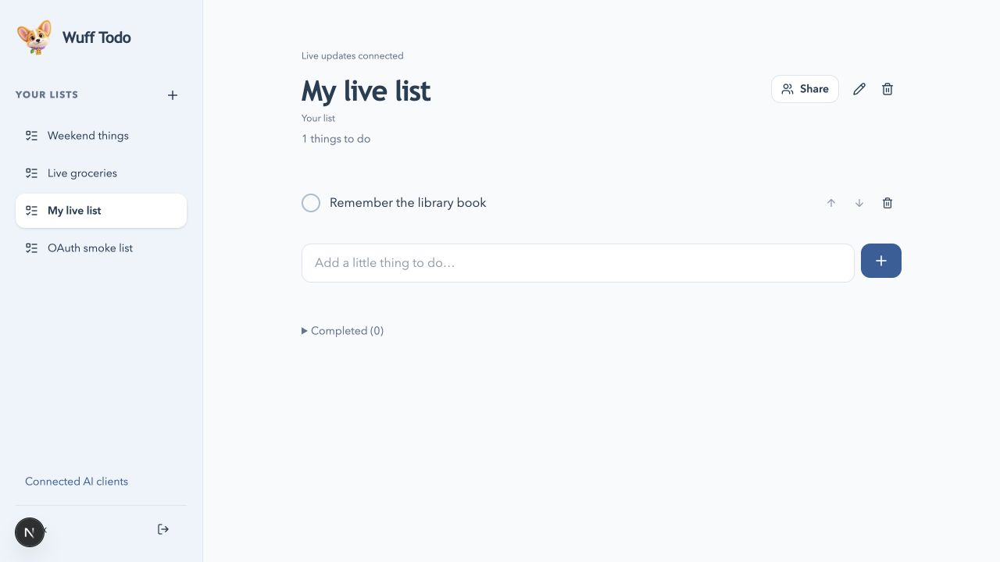
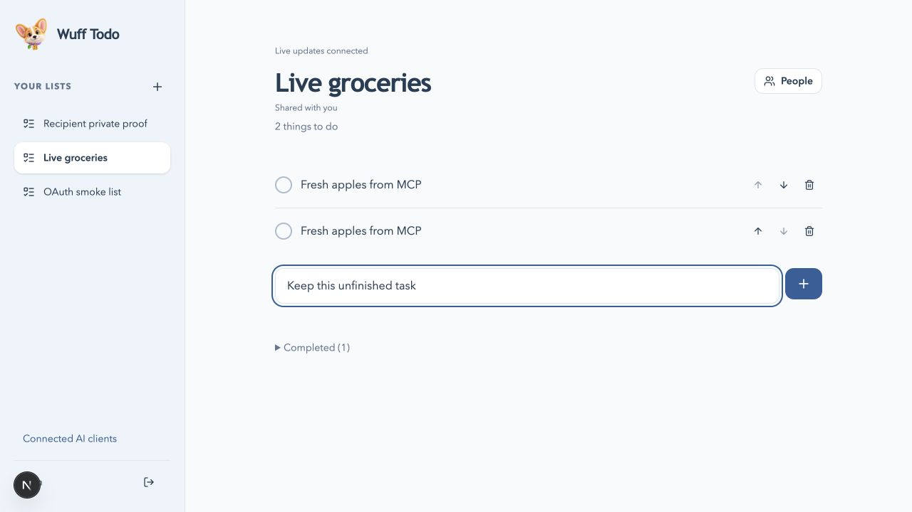

# Live list updates

Implemented October 16, 2026. No PWA, offline persistence, queued disconnected edits, native application, new database project, or application schema migration was added.

## Behavior

An open web list updates after committed task additions, edits, completion/reopening, deletion, or reordering, whether the write comes from another collaborator, another browser, or authenticated MCP. This includes one user keeping a private list open while changing it through their AI client. List creation, rename, deletion, accepted membership, leaving, and revocation also affect the subscribed list catalog.

The website shows connection state and retains ten-second polling plus focus/visibility refresh as fallback. Existing in-memory list caching remains; task drafts stay in their input fields during remote refreshes. Invitation inbox and sharing-panel details keep their existing polling behavior. The embedded MCP App itself does not acquire a live website subscription; it still operates through tool results.

## Design and permissions

- A domain-owned read-only SQL query selects accessible list IDs, titles, owner IDs, and versions. It includes enabled `wuff_users` admission and current owner/member predicates as live dependencies.
- The Next.js backend authenticates the session and seals that query using `@neon/realtime` 0.1.0. The browser uses `@neon/realtime-react` 0.1.0 and one WebSocket client per mounted account. No database or sealing secret enters client bundles.
- Short-lived capabilities are bearer credentials kept only in memory. `POST /api/v1/live` renews them with same-origin, admission, and expected-user checks. Existing list-page API calls also include an expected-user header; switching accounts forces an old page to reload instead of writing under the new identity.
- Live query data signals that a fresh API read is needed. It is not rendered directly over local state: the current API/domain permission checks, monotonically increasing list versions, cache generations, and idempotent mutation handling remain authoritative.
- A refresh queue coalesces events, waits during a local write, and repeats if an event arrives during an in-flight read. Reconnect snapshots also trigger reconciliation. The SDK renews capabilities and reconnects; terminal failures fetch a fresh query/subscription while polling continues.
- Membership revocation removes the list from the live query. The resulting API reconciliation clears the cached/open list. A disabled profile yields no rows. The query is a read path only; writes continue through the existing API/domain services.

Neon Realtime is in beta. These are tested application behaviors, not a service latency guarantee. Sources: [Neon Realtime overview](https://neon.com/docs/realtime/overview), [query authorization](https://neon.com/docs/realtime/guides/queries), [React bindings](https://neon.com/docs/realtime/guides/reactivity).

## Configuration

The existing Frankfurt project and its isolated development/main branches are reused. Realtime was enabled using the Neon CLI; production URL/secret were stored using the Vercel CLI. Only localhost:3000 and the production website origin are allowed on their respective branches. Development and production secrets are distinct and remain in ignored files / Vercel secrets. Preview origin support is separate future work.

## Verification

- `pnpm check`: workspace/root TypeScript, 12 unit tests, and an optimized Next.js production build passed.
- `pnpm test:integration`: 10 tests passed against isolated development, including actual Neon WebSocket subscriptions, separate synthetic identities, private-list isolation, pending invitation isolation, accepted membership, shared task writes, revocation, disabled admission, capability renewal, transport disconnection/reconnect, and old-account request rejection.
- Authenticated OAuth/MCP integration tests now assert that private and shared MCP mutations advance the live subscription’s version. The browser fixture used actual MCP HTTP tool calls, not direct client-side state edits.
- Browser QA confirmed a shared-list MCP addition and completion, same-user private-list MCP addition, preserved unfinished task text, and disappearance of an open list after MCP membership removal. Screenshots use synthetic accounts. A 390px viewport had no horizontal overflow.
- Production static JavaScript was checked for the actual development/production sealing-secret values and domain SQL; neither was present.
- Test setup was isolated after an existing disabled-user test interfered with shared fixtures. Integration files run serially, retain explicit concurrency cases, and respect bounded sign-in retry delays. Authentication protections were not weakened.

Actual ChatGPT client sign-in/tool selection, Joreel’s independent account/client session, native devices, and named-host embedded UI remain separate checks. This feature reacts to committed MCP changes regardless of client, but that does not certify every host.

