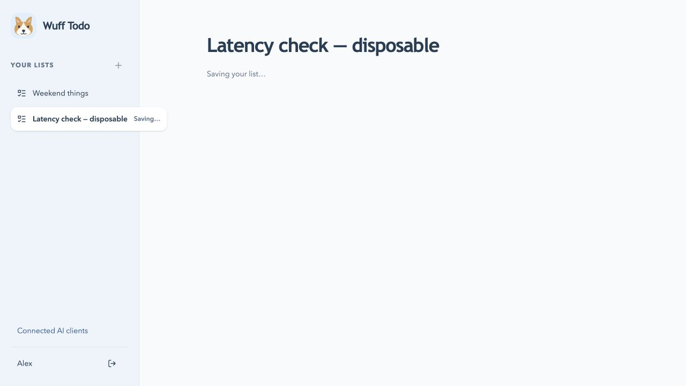

# List responsiveness

October 15, 2026

## Findings

The production deployment `dpl_Ece7Kx9CNbA419FT9eb9twGHuUqg` was actually placed in `iad1`, despite the app-level build configuration containing `fra1`. The Vercel deployment API confirmed `regions: ["iad1"]`; the project default was also `iad1`. Neon is in Frankfurt. Repeated database round trips therefore crossed the Atlantic.

The create-list UI also waited for POST creation, GET sidebar summaries, then GET the newly created list. The POST already returns the complete list. Every selection cleared visible content and waited for another read. Every mutation additionally refreshed the entire sidebar.

The database diagnostics reported tiny relations (application tables around 8–16 kB). Query statistics were unavailable because `pg_stat_statements` is not installed; no extension was installed. This is not a complete SQL execution-plan analysis.

A synthetic isolated-development benchmark from the local European machine measured warm sidebar reads around 59–60 ms, full list reads around 146–150 ms, and creation around 354 ms. These include network/transaction overhead and exclude web authentication. They are not production latency measurements. One local HTTP sidebar response reported approximately 267 ms for authentication/admission and 59 ms for the domain read.

## Changes

- Vercel project defaults now select `fra1`. Root `vercel.json` pins Frankfurt for CLI deployment from the monorepo root; `apps/web/vercel.json` retains the same choice for the web project. Verify the actual deployment region, not just the build configuration.
- The server provides the first list with the initial page, eliminating a hydration-dependent read. Identity lookup deduplicates within the React server render only; subsequent HTTP requests still validate sessions and admission.
- List creation shows a temporary list immediately with an explicit saving state. A failed or unknown result retains the request and exposes retry using its original idempotency key. Editing tasks starts after creation is confirmed.
- Successful writes update list content and sidebar metadata from their existing responses, without a second sidebar read or a newly-created-list refetch.
- Visited lists display from memory while revalidating. Pointer/focus intent can prefetch an unvisited list; concurrent reads deduplicate. No private snapshots enter localStorage or a shared server cache.
- Polling still checks every ten seconds and on focus, in parallel. Mutation generations and list versions protect against late responses; denied/deleted lists clear cached content. Sign-out clears the cache.
- Successful list API responses provide duration-only `Server-Timing` headers for authentication/admission and domain work, plus `X-Wuff-Region`. These contain no list contents or credentials.

## Verification

Eight unit tests and seven isolated-development integration tests pass, as do workspace type checks and the production build. Cache tests cover immediate reads, request deduplication, stale reads after writes, revoked/deleted data, sign-out, and retry after read failure.

A temporary loopback-only test proxy added a 2.5-second delay and rejected the first create request. Browser checks observed the new list immediately with “Saving your list…”, then an explicit failure and retry action. Retry used exactly the same operation ID and successfully created one list. The proxy is not part of the app or deployment.

Neon's idle compute can still require waking after inactivity. The region correction and UI changes do not eliminate all first-request/cold-start delay. See [Neon scale to zero](https://neon.com/docs/introduction/scale-to-zero) and [Vercel function regions](https://vercel.com/docs/functions/configuring-functions/region).
