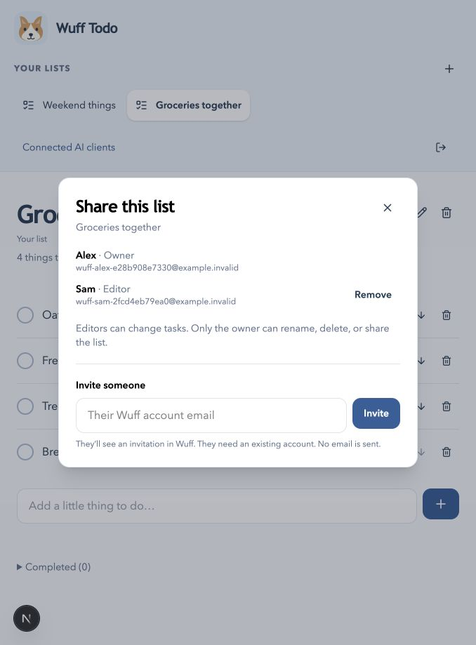
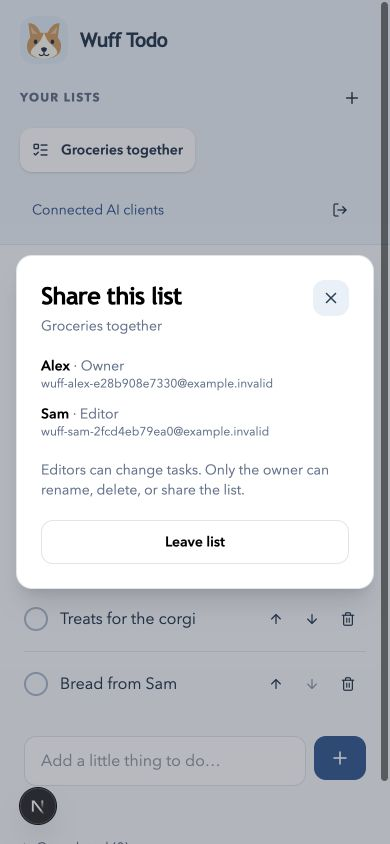

# Existing-account list sharing

Implemented October 15, 2026.

Open an owned list and choose **Share**. Enter the other person’s existing Wuff account email and choose **Invite**. They see **You’re invited** on their lists page and accept or decline there. No email is sent and public signup remains closed.

Accepted editors can add, edit, complete, reopen, delete, and reorder tasks. The owner alone renames/deletes the list, invites people, cancels pending invitations, and removes members. Editors can open **People** and leave. Invitations expire after seven days; inviting again creates a new invitation after the previous one is closed or expired. Private lists stay private.

Invitations show only the list title and owner before acceptance. Membership is authoritative for every web/API/MCP operation. Removing access blocks subsequent server reads and writes even when the former editor retains a valid session or MCP connection. The active web app checks changes on focus and every ten seconds, so a previously rendered screen may remain visible until its next refresh.

## MCP tools

- `get_list_sharing`: owner/editor identities and list version; pending invitations only for the owner.
- `list_invitations`: pending invitations addressed to the connected user.
- `invite_to_list`: owner invites an admitted account by email.
- `respond_to_invitation`: recipient accepts or declines.
- `cancel_invitation`: owner cancels a pending invitation.
- `remove_list_member`: owner revokes an editor’s access.
- `leave_list`: editor leaves.

Tools work without an embedded UI. The existing MCP App continues to browse accepted lists and manage tasks. Sharing settings and the invitation inbox have website controls; sharing tools return structured results to AI clients. The sharing milestone added seven tools (18 total at that point). The mature-list milestone brings the catalog to 25; refresh the client’s tool catalog after deployment.

Owner changes and leaving require the current list version. Each mutation takes an operation ID UUID: reuse it with exactly the same payload when retrying an uncertain response. Concurrent changes may return a conflict; read fresh state before a new operation. Old acceptance receipts never restore revoked membership.

## Verification

Synthetic Alex and Sam accounts on the isolated development branch exercised invitations, acceptance, shared editing, owner-only actions, and revocation through the browser, website API, and authenticated MCP transport. Domain tests additionally cover wrong recipients, unadmitted accounts, expiry, decline, cancellation, duplicate invitation requests, identical concurrent acceptance, leaving, scope limits, and task-write/revocation races.

Desktop and 390px browser checks covered owner sharing, recipient acceptance, editor task creation, membership removal, phone overflow, and Escape/focus restoration. These are browser viewport checks, not native iPhone/Android tests. No real user list was shared or changed for testing, and Joreel’s independent account/connection remains a user check.

## Sidebar sharing cue — October 22, 2026

Shared lists show a small people icon beside their title in the website sidebar, including archived lists. The icon has a `Shared list` tooltip and screen-reader text. Private lists retain the existing row appearance. The embedded MCP list catalog uses a matching `Shared` status tag.

List summaries and snapshots expose an additive `shared` boolean from current membership records. A pending invitation alone does not mark a list shared. Owners and editors receive the same status; removing the last editor returns the list to private. Existing live refresh/polling updates the catalog, and mutation snapshots retain the status when updating the sidebar. No migration or permission change is needed.

Verification: `pnpm check` passed (workspace/root TypeScript, 56 unit tests, optimized web/MCP builds). The focused isolated-development identity-bound invitation integration test passed with assertions for pending invitations, accepted owner/editor snapshots/catalogs and removal of the last member. The final MCP tag styling was bundled again successfully with `pnpm build:mcp`. A signed-in synthetic browser on the local production build showed the people icon and accessible label only on the shared preview list, alongside private lists. [Desktop screenshot](screenshots/sidebar-sharing-desktop.png). The disposable shared preview was removed after inspection. No production deployment, responsive viewport review, physical-device or named MCP-host UI verification was performed for this change.
